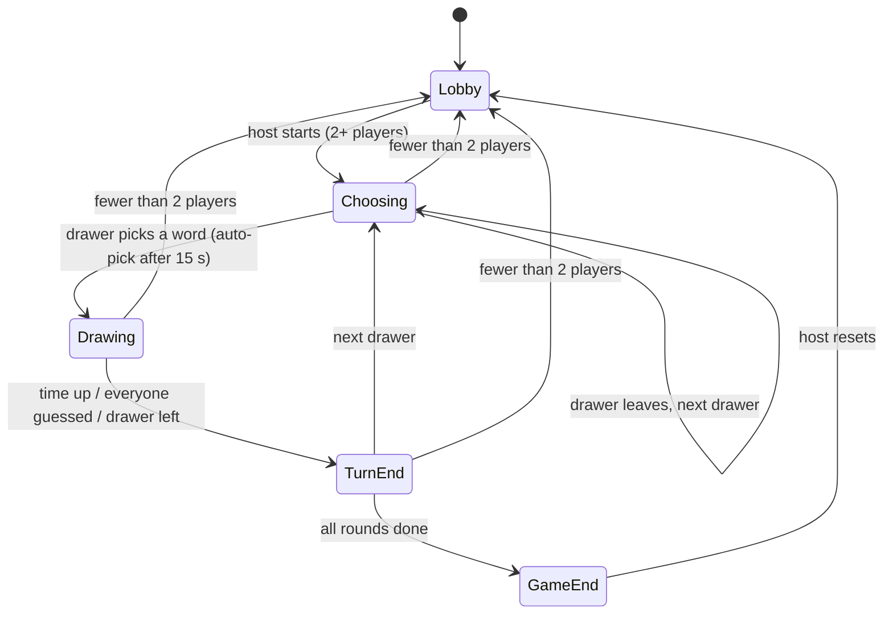
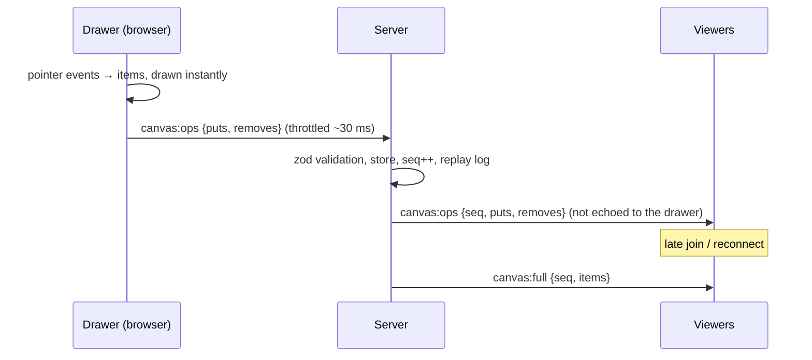

# Doodle Arena — Architecture

This document describes the system as it is built today: what the pieces are, how they connect, and how each part works.

- [1. System overview](#1-system-overview)
- [2. Monorepo layout](#2-monorepo-layout)
- [3. Shared contract](#3-shared-contract)
- [4. Server](#4-server)
- [5. Canvas](#5-canvas)
- [6. Web app](#6-web-app)
- [7. Layout and responsiveness](#7-layout-and-responsiveness)
- [8. Tooling and code quality](#8-tooling-and-code-quality)
- [9. Testing](#9-testing)
- [10. Build and deployment](#10-build-and-deployment)
- [11. Security model](#11-security-model)
- [12. Design decisions and current limits](#12-design-decisions-and-current-limits)

---

## 1. System overview

Doodle Arena is a real-time multiplayer draw-and-guess game. One player draws a secret word, the others guess it in chat.

```
 ┌─────────────────────────── Browser (React) ───────────────────────────┐
 │  pages ─ components ─ hooks ─ stores (zustand) ─ services             │
 │        │                                   │                          │
 │   TanStack Query (HTTP)             Socket.IO client (WebSocket)      │
 └────────┼───────────────────────────────────┼──────────────────────────┘
          │  GET /api/rooms/:id               │  typed events (ClientEvent / ServerEvent)
          ▼                                   ▼
 ┌────────────────────────── Node server (one process) ──────────────────┐
 │  http server ── sirv (static web app)                                 │
 │  socket handlers ── zod payload schemas ── rate limits ── IP gate     │
 │            │                                                          │
 │        Registry ──► Room (state machine) ──► CanvasStore, timers      │
 │            │                                                          │
 │     snapshot file (restart recovery)                                  │
 └───────────────────────────────────────────────────────────────────────┘
```

- **The server is the authority.** It owns the word, the clock, hints, guess checking, scores, who may draw and who may see what.
- **One process, in-memory rooms.** Rooms live in memory and are snapshotted to a small file so a restart keeps lobbies and seats.
- **One deployable.** The same Node process serves the built web app, a small HTTP API and the WebSocket game server on one port.
- **One shared contract.** Events, enums, limits and data shapes live in `@doodle/shared`, which both ends compile against.
- **Own canvas.** Drawing is a custom 2D-canvas engine in the web app (pen, eraser, bucket fill, undo).

---

## 2. Monorepo layout

A pnpm workspace (`pnpm-workspace.yaml` → `apps/*`).

```
apps/
  shared/   @doodle/shared   Enums, constants, types (TypeScript source, no build step)
  server/   @doodle/server   Game server: Socket.IO + HTTP, rooms, scoring, validation
  web/      @doodle/web      React 19 app: pages, canvas engine, stores
docs/                         This document
Dockerfile, docker-compose.yml   One-image deployment
eslint.config.mjs, .prettierrc.json   Shared quality rules
.github/workflows/ci.yml      CI pipeline
```

Dependencies point one way:

```
web ──► shared ◄── server
```

`web` and `server` never import each other. The server bundles `@doodle/shared` into its output (`tsup` with `noExternal`); Vite compiles it for the web app.

---

## 3. Shared contract

`apps/shared/src` is the single source of truth for what both sides agree on.

| Location | Contents |
|---|---|
| `enums.ts` | `Phase`, `ChatKind`, `TurnEndReason`, `JoinErrorCode`, `CanvasRejectReason`, `ToastKind`, `ClientEvent`, `ServerEvent`, `ItemKind`, `BrushSize`, `PaletteColor`, `PackId` and others |
| `constants/` | Game rules (`SCORING`, `HINTS`, `CLOSE_GUESS`, timings), `LIMITS`, canvas geometry, palette and brush widths, avatars, word packs, route patterns |
| `types/` | `RoomView`, `RoomSettings`, `ChatMessage`, `CanvasItem`, `ReplayTurn` and the typed Socket.IO event maps |
| `utils.ts` | `clampInt` |

There are no hardcoded strings or magic numbers: event names, phases and error codes are enums, and tunables are named constants. UI text is in the web app's `constants/copy/`; server messages are in `server/src/constants/messages.ts`.

### Socket events

| Client → server | Purpose |
|---|---|
| `room:create`, `room:join`, `room:leave` | Lifecycle (create and join use acknowledgements) |
| `room:settings` | Host changes rounds, draw time, packs, custom words |
| `game:start`, `game:reset` | Host starts a game / returns to the lobby |
| `turn:pick` | Drawer picks one of three words |
| `canvas:ops`, `canvas:full` | Drawing updates / full canvas resync |
| `chat` | A chat line or a guess |
| `time:sync` | Clock-offset measurement |

| Server → client | Purpose |
|---|---|
| `state` | A personalised `RoomView` for that player |
| `chat` | A chat message that player may see |
| `canvas:ops`, `canvas:full` | Relayed drawing / authoritative canvas snapshot |
| `canvas:reject` | A drawing message was refused, with the reason |
| `replay` | The stroke-by-stroke log of every drawing, sent at game end |
| `toast`, `kicked` | Notices |

The transport is WebSocket only, with compression off.

---

## 4. Server

`apps/server/src`

```
index.ts            Wires HTTP server, Socket.IO, registry and graceful shutdown
config/             env.ts (env vars), envVars.ts (enum), rates.ts (rate-limit budgets)
constants/          http, logs, messages, server tunables
game/               room.ts (state machine), roomView, chatRoute, turnTimers, scoring, hints,
                    guess, settings, wordPool, roomHelpers
canvas/             canvasStore.ts (authoritative canvas + replay log), itemValidation.ts (zod)
registry/           Room directory, snapshot and restore
security/           Token-bucket rate limiter, per-IP gate (LRU)
http/               httpServer.ts (static files + JSON API), stats.ts
socket/             handlers.ts, schemas.ts (zod), clientIp.ts
utils/, data/       id and text helpers, word lists
```

### 4.1 Room state machine

`game/room.ts` is a plain class with an injected clock and hooks, so it runs under unit tests without a network.



- **Turn order:** each player draws once per round; the queue is rebuilt each round from connected players.
- **Timers:** `game/turnTimers.ts` wraps the phase timer and the hint timers behind one `clear()`.
- **Scoring** (`game/scoring.ts`): a correct guess scores `100` base, plus up to `400` for time left, plus up to `50` for being early (10 less for each earlier guesser). The drawer earns 30% of every correct guess.
- **Hints** (`game/hints.ts`): 1 to 3 letters are revealed at fixed fractions of the draw time, depending on word length.
- **Guess checking** (`game/guess.ts`): normalised comparison. A guess is "close" when its Damerau–Levenshtein distance to the word is at most 1 (at most 2 for words of 8+ letters), for words of 4+ letters.
- **Words** (`game/wordPool.ts`, `data/words.ts`): six packs of word lists (Classic 488 words, Animals, Food, Everyday Things, Places, Tech), plus the host's custom words. Each turn offers three words. Each room remembers the words it has used across games and starts over only when the pool runs out.

### 4.2 Who may see what

- `game/roomView.ts` builds a **per-player `RoomView`**. The secret word is only placed in the view of the drawer, of players who already guessed, and after the turn ends. Spectator payloads never contain it.
- The host's custom word list is sent to the host only; everyone else receives `customWordCount`.
- `game/chatRoute.ts` routes each chat line: normal chat, a secret channel (drawer and correct guessers only), or a correct guess. A player still guessing who types the answer scores the point instead of leaking it.
- A "close!" nudge goes only to the guesser who triggered it.
- Clients never report "I guessed it". They send raw text; the server compares it and scores from its own clock.

### 4.3 Reconnects, joins and restarts

| Situation | Behaviour |
|---|---|
| Refresh or dropped connection | The seat is kept for 30 s (`GRACE_MS`). Re-joining with `{playerId, token}` restores score and "already guessed". A second tab with the same identity takes over and the old connection is closed. |
| Join mid-round | The new player receives `canvas:full` and their personalised `state`. |
| Drawer disconnects | Other players see a banner; if the drawer does not return in time the turn ends as "drawer left". |
| Drawer leaves while choosing | The turn is skipped immediately. |
| Fewer than 2 players | Return to the lobby. |
| Host leaves | Host passes to the next connected player. |
| Server restart | `registry/registry.ts` writes a snapshot (room id, settings, host, each player's `{id, token, name, avatar}`) at most every 5 s and on shutdown, atomically. On boot, rooms are restored **as lobbies** and players re-attach with their token. Unclaimed seats are dropped after 60 s. Turns in progress, scores and drawings are not restored. |

### 4.4 HTTP

`http/httpServer.ts`:

- `GET /api/rooms/:id` → `{ exists, players, maxPlayers, phase, host }` (used by the join page)
- `GET /api/stats` → room, player and socket counts (used by the load test)
- `GET /healthz` → `{ ok: true }`
- Everything else is served by `sirv` from the built web app, with SPA fallback; hashed assets under `/assets` are sent as immutable.

Creating and joining a room happens over the socket with acknowledgements, so the seat and token are issued on the same connection that carries the game.

### 4.5 Configuration

| Variable | Default | Meaning |
|---|---|---|
| `PORT` | `8080` | Listen port |
| `MAX_ROOMS` | `20000` | Room cap |
| `GRACE_MS` | `30000` | Seat kept after a disconnect |
| `CHOOSE_MS`, `TURN_END_MS` | `15000`, `6000` | Word-pick and turn-end durations |
| `DATA_FILE` | `apps/server/data/rooms.json` | Restart snapshot; empty disables it |
| `STATIC_DIR` | built web app | Directory served as static files |
| `TRUST_PROXY` | off | `1` behind a reverse proxy (uses `X-Forwarded-For`) |
| `CORS_ORIGIN` | any | Comma-separated allowed origins |
| `IP_RATE_LIMIT` | on | `off` disables the per-IP join gate |

---

## 5. Canvas

The drawing engine is our own. It lives in the web app, with a matching validator and store on the server.

### 5.1 Data model

One record describes everything on the sheet (`@doodle/shared`):

```ts
interface CanvasItem {
  id: string          // unique, [A-Za-z0-9_-]{4,48}
  kind: 'pen' | 'eraser' | 'fill'
  color: PaletteColor // 13 fixed colours
  size: BrushSize     // s | m | l | xl → line width on the sheet
  points: number[]    // flat [x0, y0, x1, y1, …]; a fill is a single point [x, y]
}
```

- The sheet is a fixed logical **1200 × 900** canvas, scaled by CSS, so a coordinate means the same thing on every screen.
- The drawing is an **ordered list** of items. Undo removes the last item, clear removes all, and a fill is an item that is replayed in order.
- The eraser paints in the background colour; a fill is a flood fill run when the item is drawn.
- Brush widths: 4, 9, 18 and 32 sheet units (the eraser is twice as wide). Coordinates are rounded to one decimal.

### 5.2 Protocol



- **Latest full item wins.** A growing stroke is re-sent whole on each flush, so every message is idempotent for its item and a lost message is repaired by the next one.
- **One sequencer per room.** A single TCP stream per client and a single-threaded server mean viewers receive operations in the order the server applied them.
- **Local drawing is immediate.** The drawer never waits for the server.
- **Recovery.** Rate-limited messages are answered with `canvas:reject {rate}`; the drawer then sends one `canvas:full` and everyone converges. A reconnect starts with `canvas:full`.

### 5.3 Server side (`apps/server/src/canvas`)

- `itemValidation.ts` — a zod schema accepts only the three kinds, known colours and sizes, an even number of finite coordinates inside the sheet (plus a 100-unit margin) and at most 6,000 numbers per item; a fill must be exactly one point; extra fields are rejected.
- `canvasStore.ts` — the authoritative `Map<id, item>` (insertion order is draw order). A batch is applied **atomically**: one bad item means nothing is stored. It enforces 48 KB per item, 600 items and 900 KB per canvas.
- **Replay log:** the store appends events as items arrive. Consecutive updates of the same stroke within 600 ms are folded into one event with a start time and a duration, capped at 4,000 events per turn.

### 5.4 Client side (`apps/web/src`)

| Piece | File | Job |
|---|---|---|
| Drawing primitives | `utils/canvasDraw.ts` | Smooth strokes (quadratic curves through midpoints), round caps, eraser, scanline flood fill with colour tolerance and edge dilation |
| Item helpers | `utils/canvasItems.ts`, `utils/canvasPoint.ts` | Apply ops to a list, compare/extend items; map screen position to sheet position (clamped to the sheet) |
| Renderer | `services/canvasRenderer.ts` | Owns the `<canvas>`. `setItems(list)` diffs against what is drawn: an appended item is drawn alone, a grown stroke draws only its new segment, anything else clears and redraws |
| Outbox | `services/canvasOutbox.ts` | Collects puts and removes, sends at most one message per ~30 ms, up to 8 items each |
| Event bus | `services/canvasBus.ts` | Receives `canvas:ops` and `canvas:full`, keeps a mirror, notifies listeners |
| Drawer input | `hooks/useDrawing.ts` | Pointer events → items, minimum point distance, pointer capture, undo/redo stack, clear |
| Streaming | `hooks/useCanvasStreaming.ts` | Connects the outbox, handles `canvas:reject`, resyncs on rate limit and reconnect |
| Viewer sync | `hooks/useCanvasMirror.ts` | Applies remote ops and snapshots to the renderer |
| Replay | `hooks/useReplayPlayer.ts`, `utils/replayMath.ts` | Builds a timeline from the server log; reveals each stroke's points progressively; idle gaps are compressed |
| Board | `pages/GamePage/Board` | A `<canvas>` with pointer handlers; text selection is disabled on it |

The same renderer serves live drawing, late joins and replay.

---

## 6. Web app

`apps/web/src` — React 19, Vite, Tailwind 4, TypeScript.

### 6.1 Folder structure

```
pages/        One folder per screen; a page owns the components only it uses
  HomePage/   JoinPage/   LobbyPage/   GamePage/   ResultsPage/   RoomPage/
components/   Components shared by several pages (Avatar, Chat, Logo, Screen, Toasts, CrashScreen …)
hooks/        All hooks
utils/        All pure helpers
services/     axios + QueryClient, socket, canvas bus/renderer/outbox, clock sync, sound
store/        zustand stores: game state, persisted session/profile, sound mute, socket bindings
constants/    Named constants and `copy/` (all UI text, split per area)
router/       Route table
types/        Local types
```

Every component is `Name/Name.tsx` plus an `index.ts`. Components use named exports and arrow functions. Cross-folder imports use the `@/` alias.

### 6.2 State and data flow

- **HTTP data** (room existence, create, join) uses TanStack Query (`useRoomInfo`, `useCreateRoom`, `useJoinRoom`).
- **Live game state** arrives over the socket into a zustand store (`store/gameStore.ts`); `store/socketBindings.ts` is the only place that turns socket events into store updates.
- **Persistence:** the session `{roomId, playerId, token}` is in `sessionStorage` (per tab); the profile (name, avatar) and the sound mute flag are in `localStorage`.
- **Clock sync:** five `time:sync` round trips (lowest round-trip wins) give a server-time offset so countdowns agree across players. Scoring never uses client time.
- **Canvas traffic bypasses React state:** the bus feeds the renderer directly.

### 6.3 Routing and loading

`wouter` routes `/` to `HomePage` and `/r/:roomId` to `RoomPage`. `RoomPage` auto-joins from a stored session, otherwise shows `JoinPage`; `SeatedRoom` then shows the lobby, game or results screen by room phase. `GamePage` and `ResultsPage` are lazy-loaded.

### 6.4 Resilience

- An error boundary (`react-error-boundary` with `CrashScreen`) catches render errors and failed chunk loads and offers *Reload* and *Back home*.
- Socket reconnects use exponential backoff and re-attach the seat; a banner shows while disconnected.
- The custom-words box keeps the host's own text while it is focused, so server updates never overwrite typing.

### 6.5 Sound

`services/sound.ts` synthesises every effect with the Web Audio API from note tables in `constants/sound.ts`; there are no audio files. `hooks/useGameSounds.ts` maps game events (chat, correct and close guesses, turn changes, countdown ticks, results) to effects. `components/SoundToggle` mutes them and the choice is persisted.

### 6.6 Replay turn picker

`pages/ResultsPage/ReplayTurnSelect` is a custom select (Radix Select) that lists each drawing grouped by round with the drawer's avatar, the word and who drew it, and shows a "n / total" counter.

---

## 7. Layout and responsiveness

1. **No page scroll.** Every screen fits the viewport; only inner panels (such as chat) scroll.
2. **Mobile first, pure CSS.** Layouts start as one column and gain structure at breakpoints. There is no JavaScript scaling.
3. **Everything is `rem`.** The root font size steps up with media queries on large screens: 16 px by default, then 18, 20, 24, 28 and 32 px at 1600, 1920, 2560, 3200 and 3840 px wide (each with a minimum height).
4. **The board keeps a 4:3 ratio.** `.fit-parent` is a size container and `.board-fit` takes the largest 4:3 box that fits, using container query units.
5. **Short landscape screens** use a custom `short` variant (height ≤ 520 px): compact headers, and the drawing toolbar becomes a vertical dock beside the board.
6. **Phones** use tab bars (Players/Chat, Players/Settings, Results/Replay) instead of stacked panels.
7. **Desktop game screen:** three columns (players, board, chat) with flexible side widths.

---

## 8. Tooling and code quality

| Concern | Tool |
|---|---|
| Package manager | pnpm workspaces |
| Server build | `tsup` (ESM bundle, shared package inlined) |
| Web build | Vite with `@tailwindcss/vite` |
| Types | TypeScript strict; `noUncheckedIndexedAccess` for production code (scripts and tests use `tsconfig.tools.json` without it) |
| Lint | ESLint flat config: typescript-eslint, react-hooks, `complexity ≤ 12`, `max-depth ≤ 4`, `max-params ≤ 5`, no nested ternaries, no non-null assertions in production code, blank-line rules |
| Format | Prettier |
| Libraries | lodash-es, zod, nanoid, limiter, lru-cache, sirv, write-file-atomic, damerau-levenshtein, clsx, usehooks-ts, react-hotkeys-hook, use-stick-to-bottom, TanStack Query, axios, wouter, zustand, Radix Select, react-error-boundary |

Root scripts: `dev`, `build`, `start`, `check` (format check, lint, typecheck, tests), `lint`, `lint:fix`, `format`, `format:check`, `test`, `e2e`, `demo-bots`, `loadtest`.

CI (`.github/workflows/ci.yml`) runs the format check, lint, typecheck, unit tests, build, the end-to-end suite and a Docker build.

---

## 9. Testing

| Layer | What it covers | Command |
|---|---|---|
| Server unit (40 tests) | Game rules, scoring, secrecy, reconnect grace, restart recovery, custom-word privacy, word-list validity and no repeats across games, canvas validation and store (atomicity, caps, ordering, replay folding) | `pnpm test` |
| Web unit (35 tests, Vitest with a real canvas rasteriser) | Item list operations, replay timeline, screen-to-sheet mapping, pen/eraser/size pixels, bucket fill (inside outlines, no anti-alias fringe, edge cases, speed), the diffing renderer (streamed equals drawn at once, undo, middle removal, clear) | `pnpm test` |
| End-to-end with bots (22 checks) | A real server and headless Socket.IO bots playing full games: cheating attempts (non-host start, non-drawer drawing, forbidden kinds, oversized strokes, chat flood, 1 MB frame) and canvas paths (undo relayed, drawer reconnect keeps the turn and canvas, `canvas:full` resync, canvas flood rate-limited, oversized resync rejected) | `pnpm e2e` |
| Demo bots | Bots that join a room, draw real doodles by streaming strokes, and guess | `pnpm demo-bots <ROOMCODE\|new> <count>` |
| Load test | N rooms × 5 bots, drawers streaming at 30 Hz; latency measured from send to receive | `pnpm loadtest --rooms 300 --procs 8 --spawn` |

---

## 10. Build and deployment

### Build

`pnpm build` builds the web app (`apps/web/dist`) and bundles the server (`apps/server/dist/index.js`). `pnpm start` builds and then runs the server, which serves both on one port.

### Docker

`Dockerfile` is multi-stage: **build** (install and build web and server) → **deps** (production dependencies only) → **runtime** (Node 22 Alpine, non-root user, health check). The container runs `node apps/server/dist/index.js` on `PORT` (default 8080). Room snapshots are written to `apps/server/data`, which `docker-compose.yml` mounts as a volume.

```bash
docker compose up --build        # http://localhost:8080
```

### Render

The app is deployed as a single Docker web service built from the repository's `Dockerfile`:

- Render supplies `PORT`, and the server reads it.
- `TRUST_PROXY=1` makes per-IP limits use real client IPs behind Render's proxy.
- WebSockets work on web services without extra settings.
- The service runs as a single instance, because rooms live in that process's memory.

---

## 11. Security model

| Threat | Defence |
|---|---|
| Edited client reads the word | The word is only in the drawer's and correct guessers' views. Asserted in the end-to-end suite. |
| Edited client reads the host's custom words | Custom words go to the host only; others get the count. |
| Edited client gives itself points | There is no "I guessed" message; points come from the server's clock. |
| Non-drawer draws | `canvas:ops` is rejected outside the drawer's `drawing` phase. |
| Answer leaks through chat | Correct guessers and the drawer chat on a secret channel; a typed answer from someone still guessing counts as their guess. |
| Malformed or oversized canvas data | Atomic zod validation, per-item and total byte caps, item caps. |
| Floods | Per-socket token buckets (chat 5 burst / 1 per s, canvas 120 / 60 per s, canvas-full 3 / 0.5 per s, controls 20 / 4 per s, joins 12 / 0.4 per s) plus a per-IP join gate; 200 strikes disconnect the socket; a 1 MB frame cap. |
| Name and chat abuse | Length limits and text sanitising on the server (names 18 chars, chat 140). |
| Seat theft | A secret per-player token is required to re-attach a seat. |

Other limits: 12 players per room, at most 8 canvas items per message.

---

## 12. Design decisions and current limits

- **In-memory state, no database.** Rooms live in the server process. A restart restores lobbies, settings and seats but not turns in progress, scores or drawings.
- **Whole-item updates.** Each stroke update carries the whole stroke, which makes messages idempotent and tolerant of loss; bandwidth per update grows with stroke length.
- **Own canvas.** The drawing engine is part of the app, so the web bundle has no drawing-library dependency; game screens are about 35 KB.
- **Raster fill.** Fill is replayed on each client over the same 1200 × 900 sheet, so tiny anti-aliasing differences between browsers are possible.
- **Single process.** One Node process handles all rooms. In a worst-case load test (every room drawing continuously at 30 Hz, 5 players per room, load generators on the same machine), 300 rooms used about half a core with p99 latency of 13 ms, and 600 rooms saturated the core with p99 of 70 ms.
- **Single instance.** Because room state is in process memory, the app runs as one instance.
